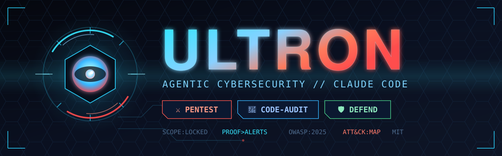

<p align="center">
  
</p>

<h1 align="center">Ultron</h1>

<p align="center">
  <b>One-stop agentic cybersecurity plugin for <a href="https://claude.com/claude-code">Claude Code</a>.</b><br>
  Offensive testing, source-code auditing, and defensive blue-team work — evidence-backed, proof-first, scope-disciplined.
</p>

<p align="center">
  
  
  
  
  
  
  
</p>

---

> [!WARNING]
> **Authorized use only.** Ultron is for systems you own or have explicit written permission to test. It defaults to loopback/private-LAN targets, refuses public third-party targets, and never performs destructive, denial-of-service, or mass-targeting actions. You are responsible for staying within your authorization and local law. See [SECURITY.md](SECURITY.md).

## ✨ What's inside

Installing the plugin gives you several skills. Each triggers on its own description — you don't choose a skill by hand, you just describe the task.

| Skill | Use it for | Posture |
|---|---|:---:|
| **⚔️ ultron** | Localhost / private-LAN web app & API penetration test. Recon → Plan → Test → Verify → Report with independent verification and an evidence-backed report. | 🔴 Offense |
| **🔎 code-audit** | White-box vulnerability review of source code (no running app required). Data-flow and authorization reasoning, each issue tied to a sink and a fix. | 🔴 Offense |
| **🛡️ defend** | Blue-team work: incident triage and DFIR, log/artifact analysis, and configuration hardening against a known threat model. | 🟢 Defense |

Shared knowledge packs — a **techniques atlas** mapping ~30 security domains (cloud, containers, identity, forensics, threat intel, and more) to the skill that owns each, a MITRE ATT&CK ↔ CWE ↔ OWASP:2025 crosswalk, breach-class patterns, and an authoritative source index — back every skill so findings map to recognized taxonomies. The atlas gives the breadth of a sprawling technique catalog in one orchestrated, proof-first reference instead of hundreds of isolated skills.

### 🧬 Reverse engineering

Ultron does **not** bundle a reverse-engineering engine. For binary, firmware, mobile, or managed-code RE, install the official **REA** plugin / `reverse-engineer-anything` skill alongside Ultron. Ultron's skills point you to it when a task needs deep RE.

## 📦 Install

```sh
# add this repo as a plugin marketplace, then install the plugin
/plugin marketplace add iamsantosh007/ultron_cyber_security
/plugin install ultron@ultron
```

Or clone locally and add the path as a marketplace in an interactive Claude Code session.

## 🚀 Usage

Just describe the job — Claude routes to the right skill:

- 💬 *"Pentest my app running on `http://localhost:3000`, source is in `./server`."*
- 💬 *"Audit this repo for security vulnerabilities."*
- 💬 *"Something hit our dev box — help me triage these logs and figure out what happened."*
- 💬 *"Harden this nginx + Postgres setup before we expose it."*

Ultron records a scope manifest, works the methodology, verifies every confirmed finding independently, and writes a `SECURITY-FINDINGS.md` report with reproductions, evidence, severity, and prioritized fixes.

## 🧭 Principles

- **Proof over alerts.** A scanner hit or risky code path is a *candidate*, not a finding, until the effect is demonstrated and independently reproduced.
- **Least-invasive evidence.** Disposable fixtures, harmless markers, no table dumps, no DoS, no brute force by default.
- **Scope-disciplined.** Validates resolved addresses, blocks out-of-scope subresources/redirects/callbacks, never scans a neighboring local service just because it's reachable.
- **Secret hygiene.** No raw credentials, tokens, or cookies in manifests, prompts, or reports.
- **Knowledge, cited.** Methodology distilled from OWASP (WSTG, Top 10, ASVS, cheat sheets), MITRE ATT&CK & CWE, NIST SP 800-115 / CSF, PTES, and CISA KEV — referenced, not copied.

## 🗂️ Layout

```
.claude-plugin/        plugin.json · marketplace.json
skills/
  ultron/              localhost web/API pentest  (+ references/)
  code-audit/          white-box source review    (+ references/)
  defend/              DFIR response & hardening   (+ references/)
references/knowledge/  techniques-atlas · attack-mapping · incident-patterns · sources
```

## 📌 Status

`v0.1.0` — all three skills (**ultron**, **code-audit**, **defend**) and the shared knowledge packs are in place. Taxonomies current as of 2026-10-26: **OWASP Top 10:2025**, **MITRE ATT&CK v18**. Expect iteration — file issues for gaps.

## 🤝 Contributing & security

- [CONTRIBUTING.md](CONTRIBUTING.md) — design principles (keep them intact), layout, and the PR checklist.
- [SECURITY.md](SECURITY.md) — how to report a vulnerability in the plugin, and the authorized-use policy.

## 📄 License

[MIT](LICENSE) © 2026 Santosh Patro
